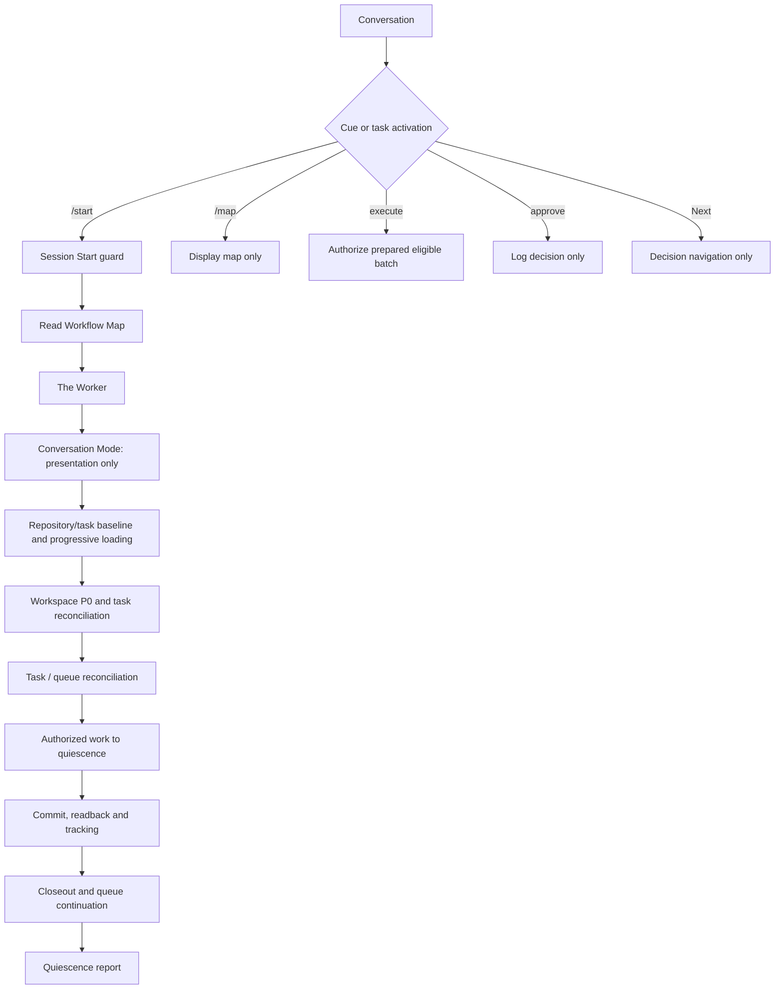
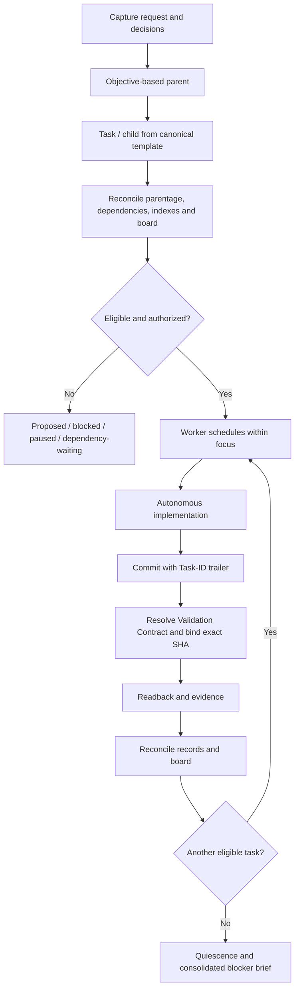
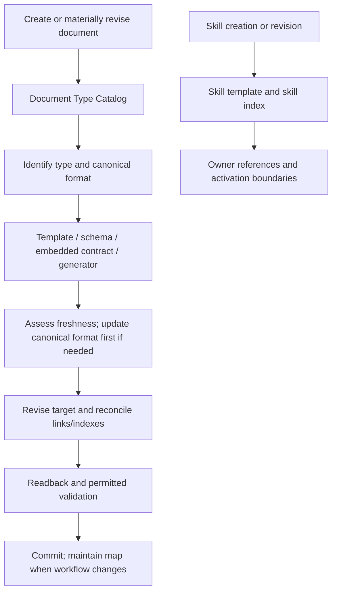
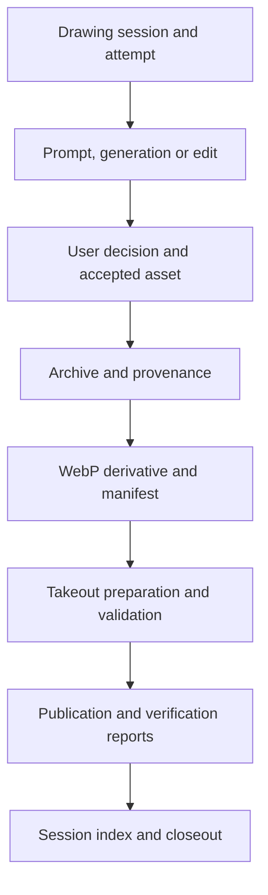

# Workflow Map

**Purpose:** A navigable overview of current repository workflows. This map routes to canonical owners; it does not replace their procedures. Read it during `/start` before loading task-specific references. The `/map` cue displays this file without initializing the session.

## Session and repository work

- Cue guard: `.agent/SESSION_START.md`; operating authority: `.agent/skills/the-worker/SKILL.md`.
- Repository file reads default to the intended branch. Commit-specific reads require traceable SHA provenance; no unexplained or stale SHA is reused.
- Presentation settings: `.agent/skills/the-worker/references/conversation-mode.md`.
- `/map` displays this map only; it does not initialize or execute.
- Standalone case-insensitive `execute` is the execution cue; approval and `Next` are log/navigation only.

## Task lifecycle and scheduling

- Task templates, subtask templates and board template: `.agent/skills/the-worker/assets/`.
- Board: `workspace/task_board.md`; records and indexes: `workspace/tasks/`.
- Drafts, analyses, ADRs and discussion registers: `workspace/decisions/`, governed by Worker decision-governance reference.
- Worker owns task capture, hierarchy, selection, blockers, commit evidence and closeout.
- Each task and subtask template includes a JSON Validation Contract. The coordinator resolves it from the commit's Task-ID trailer and binds it to the exact source SHA.

## Document and skill governance

- Catalog: `.agent/skills/the-worker/references/document-type-catalog.md`; reusable templates are in skill-owned `assets/`.
- Skill index: `.agent/skills/README.md`; skill authoring: `.agent/skills/agent-skill-authoring/`; Skill Creator has its specialized workflow.
- Novel/story: `.agent/skills/romantic-storyteller-visual-artist/` and `area/novel/`.
- Drawing: `.agent/skills/drawing/` (attempts, continuity, patterns, image editing, archive and delivery).
- Specialist skill activation is conditional and routed through the skill index and Worker gates.

## CI, reports and remediation

~~~mermaid
flowchart TD
 A[Source commit on gpt] --> B[Dispatcher policy and duplicate-SHA gate]
 B -->|Enabled| C[One exact-SHA coordinator]
 B -->|Staged / duplicate| D[Legacy validation remains active]
 C --> E[Reusable checks plus generic verifier]
 E --> F[Exact-SHA aggregate]
 F --> G[Isolated publisher]
 G --> H[Compact status index and per-attempt review folder]
 H --> I[Worker index-first review queue]
 I --> J[Failure-only log diagnosis]
 J --> K[Root-cause grouped remediation children]
 H --> L[Recovery sweep: runs, artifacts, checkpoint and retention]
~~~

- Activation: relevant source pushes are routed by .github/workflows/task-validation-dispatch.yml. The dispatcher is currently policy-gated and staged; legacy validation workflows remain active until migration is complete.
- ADR-0008 workflows: dispatcher .github/workflows/task-validation-dispatch.yml; reusable coordinator .github/workflows/task-validation.yml; generic verifier .github/workflows/task-validation-verifier.yml; isolated publisher .github/workflows/task-validation-publisher.yml; recovery .github/workflows/task-validation-recovery.yml.
- Worker-owned contracts, schemas, adapters, publisher/recovery scripts and tests: .agent/skills/the-worker/assets/task-validation/ and .agent/skills/the-worker/scripts/. Interface and ownership guide: .agent/skills/the-worker/references/task-validation-interfaces.md.
- Operational status index, checkpoint and review queue: workspace/task-validation/. The Worker reads the index first and opens logs only for recorded actionable failures. It does not rerun or override committed validation.
- Recovery uses Actions run metadata and aggregate artifacts, not logs. Its push and post-publication paths are available on gpt. The scheduled trigger is not active because the repository default branch is main; scheduled workflows run only from the default branch. Activation requires changing the default branch or using an external scheduler.
- Effective branch protection, default-branch availability for scheduled and workflow-dispatch recovery, and publisher write access remain external prerequisites. Coordinator activation stays staged until policy protection, workflow migration, publisher/recovery operation and report migration gates are satisfied.
- .takeout/reports/ remains intact until ADR-0008 Confirmation proves every producer/consumer migrated and coverage preserved. Do not delete it early.
- No automatic startup CI baseline, report scan, or recovery sweep. CI review is activated by its workflow or an explicitly assigned task, not general session initialization.
- Source attribution comes only from the exact Task-ID commit trailer. If the source parent is unavailable, ADR-0008 routes remediation to one permanent fallback parent; never infer parentage. The Worker alone owns scheduling and task lifecycle; the publisher does not schedule.
- The legacy CI Ledger remains only for pre-migration report findings until the approved migration is complete. ADR-0008 coordinator attempts are owned by the Worker review queue; do not create a parallel findings archive.
- Historical backfill and hosted CI access remain governed; this map grants no permission.

## Image, drawing and takeout

- Worker image procedures and focused drawing references own processing, provenance, storage and WebP.
- Drawing skill: `.agent/skills/drawing/`; image processing and verification scripts are routed from The Worker.

## Specialist routing

| Workflow | Entry / owner | Scope |
|---|---|---|
| Repository sessions, tasks, documents, decisions, CI | The Worker | Cross-cutting canonical operating authority |
| Skill creation / authoring | Agent Skill Authoring; Skill Creator | Creation, structure and bounded activation |
| Drawing / image iteration | Drawing | Attempt records, continuity, editing, patterns and delivery |
| Narrative / novel | Romantic Storyteller Visual Artist | Story hierarchy, arcs, scenes and illustration records |
| PDF | PDF skill | Form and reference procedures |
| Prompt design | Prompt Master | Prompt framework, templates and patterns |
| STE-100 writing / lint | ASD-STE100 | Writing rules and lint tooling |
| Visual themes | Theme Factory | Theme definitions and assets |
| Other specialist skills | `.agent/skills/README.md` | Activation requirements and scope |

## Map maintenance

Whenever a workflow, cue, owner boundary, activation prerequisite, or operational route changes, update this map in the same governed change cycle. Review it against owner files, read back both map and owners, and include the map in the commit. The map summarizes and routes; it does not duplicate detailed procedures or become a competing authority.
