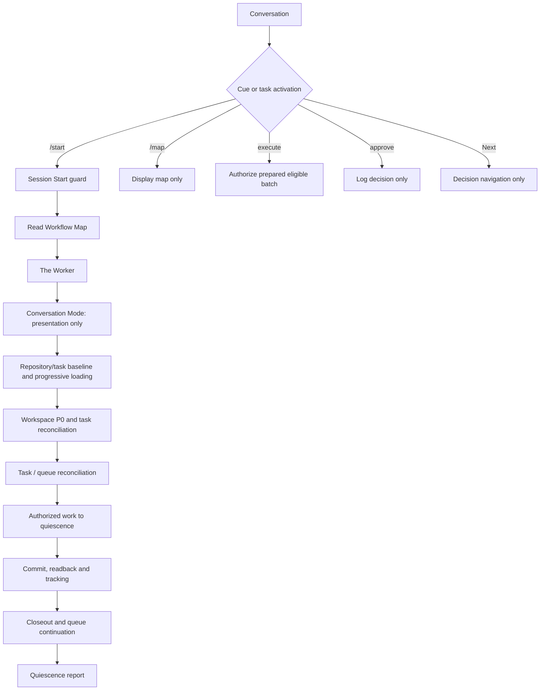
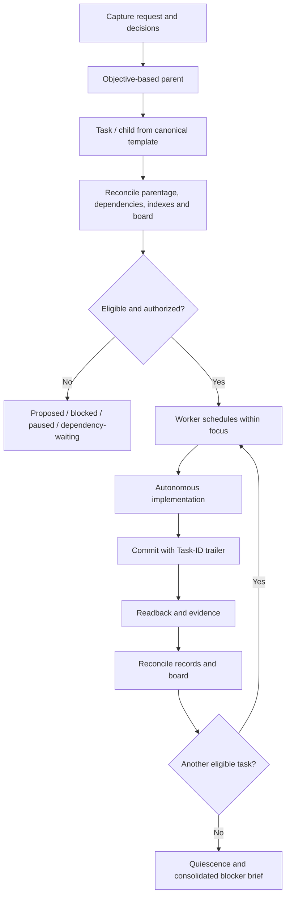
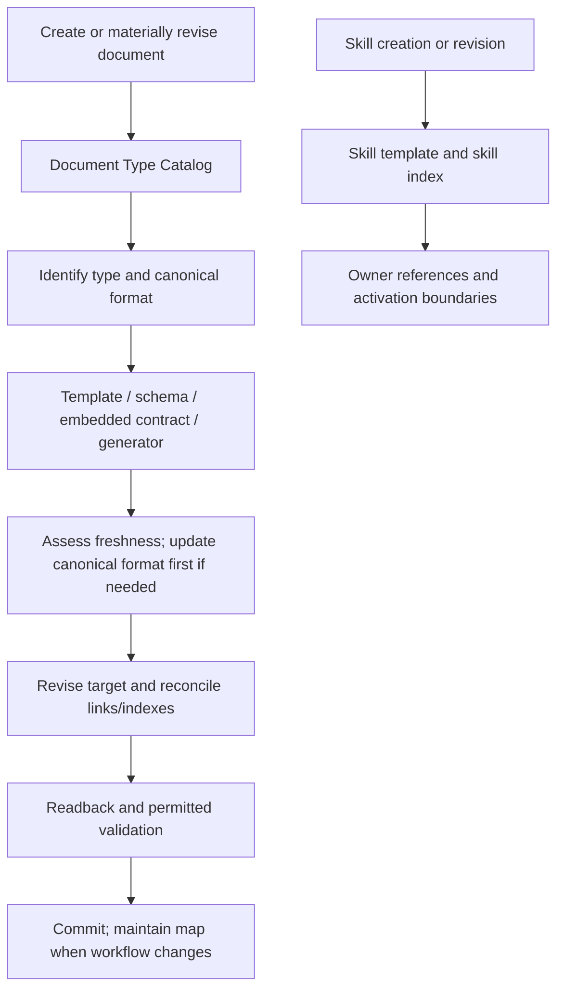
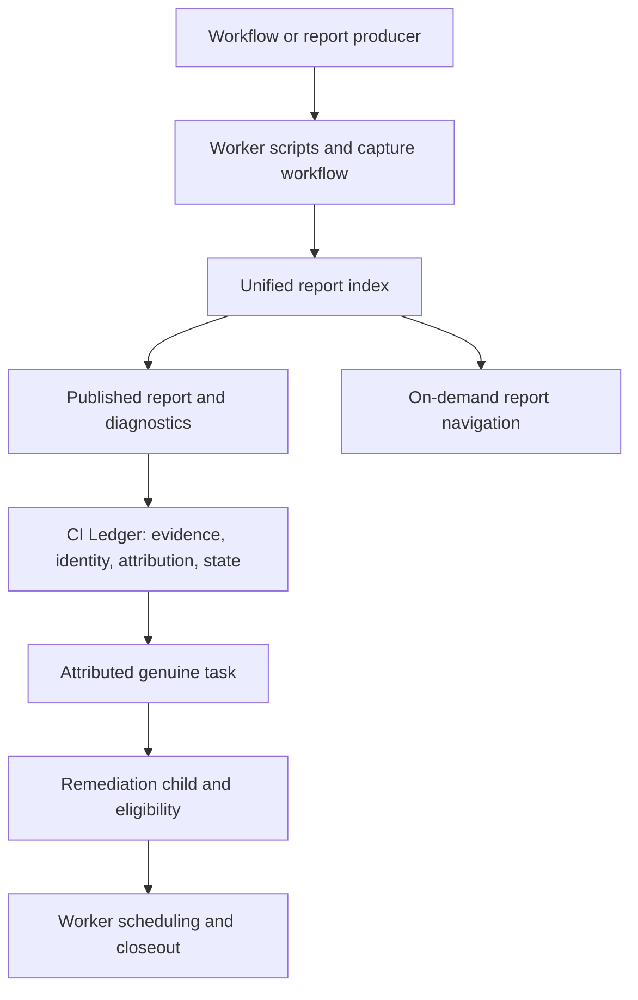
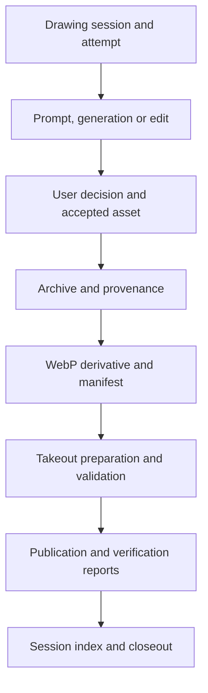

# Workflow Map

**Purpose:** A navigable overview of current repository workflows. This map routes to canonical owners; it does not replace their procedures. Read it during `/start` before loading task-specific references. The `/map` cue displays this file without initializing the session.

## Session and repository work

- Cue guard: `.agent/SESSION_START.md`; operating authority: `.agent/skills/the-worker/SKILL.md`.
- Presentation settings: `.agent/skills/the-worker/references/conversation-mode.md`.
- `/map` displays this map only; it does not initialize or execute.
- Standalone case-insensitive `execute` is the execution cue; approval and `Next` are log/navigation only.

## Task lifecycle and scheduling

- Task templates, subtask templates and board template: `.agent/skills/the-worker/assets/`.
- Board: `workspace/task_board.md`; records and indexes: `workspace/tasks/`.
- Drafts, analyses, ADRs and discussion registers: `workspace/decisions/`, governed by Worker decision-governance reference.
- Worker owns task capture, hierarchy, selection, blockers, commit evidence and closeout.

## Document and skill governance

- Catalog: `.agent/skills/the-worker/references/document-type-catalog.md`; reusable templates are in skill-owned `assets/`.
- Skill index: `.agent/skills/README.md`; skill authoring: `.agent/skills/agent-skill-authoring/`; Skill Creator has its specialized workflow.
- Novel/story: `.agent/skills/romantic-storyteller-visual-artist/` and `area/novel/`.
- Drawing: `.agent/skills/drawing/` (attempts, continuity, patterns, image editing, archive and delivery).
- Specialist skill activation is conditional and routed through the skill index and Worker gates.

## CI, reports and remediation

- Activation: CI work is handled only for an assigned, selected task under `workspace/tasks/` and within its authorized scope. It is not part of general session initialization.
- Procedures: `.agent/skills/the-worker/references/ci-ledger.md` and `github-actions.md`, loaded only when the assigned CI task requires them.
- Canonical implementation: `.agent/skills/the-worker/scripts/`; capture workflow: `.github/workflows/gh-actions-capture.yml`.
- Report index and data: `.takeout/reports/`; navigation guide: `.takeout/reports/README.md`.
- No automatic startup CI baseline, report scan, or Ledger reconciliation. Do not access `.takeout/reports/` for general setup or unrelated tasks.
- Attribution is source-task-based, not guessed. The Ledger does not schedule or create parents.
- Historical backfill and hosted CI access remain governed; this map grants no permission.

## Image, drawing and takeout

- Worker image procedures and focused drawing references own processing, provenance, storage and WebP.
- Drawing skill: `.agent/skills/drawing/`; image processing and verification scripts are routed from The Worker.

## Specialist routing

| Workflow | Entry / owner | Scope |
|---|---|---|
| Repository sessions, tasks, documents, decisions, CI | The Worker | Cross-cutting canonical operating authority |
| Skill creation / authoring | Agent Skill Authoring; Skill Creator | Creation, structure and bounded activation |
| Drawing / image iteration | Drawing | Attempt records, continuity, editing, patterns and delivery |
| Narrative / novel | Romantic Storyteller Visual Artist | Story hierarchy, arcs, scenes and illustration records |
| PDF | PDF skill | Form and reference procedures |
| Prompt design | Prompt Master | Prompt framework, templates and patterns |
| STE-100 writing / lint | ASD-STE100 | Writing rules and lint tooling |
| Visual themes | Theme Factory | Theme definitions and assets |
| Other specialist skills | `.agent/skills/README.md` | Activation requirements and scope |

## Map maintenance

Whenever a workflow, cue, owner boundary, activation prerequisite, or operational route changes, update this map in the same governed change cycle. Review it against owner files, read back both map and owners, and include the map in the commit. The map summarizes and routes; it does not duplicate detailed procedures or become a competing authority.
